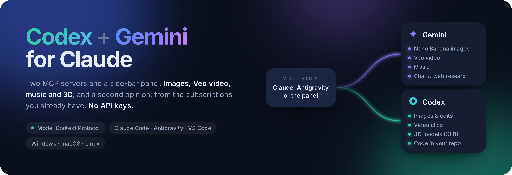
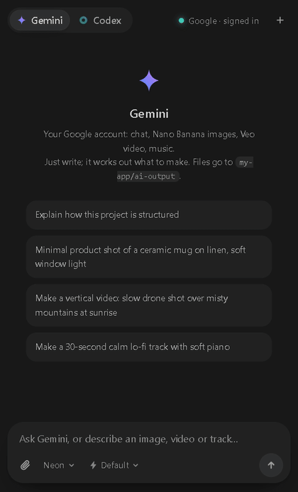
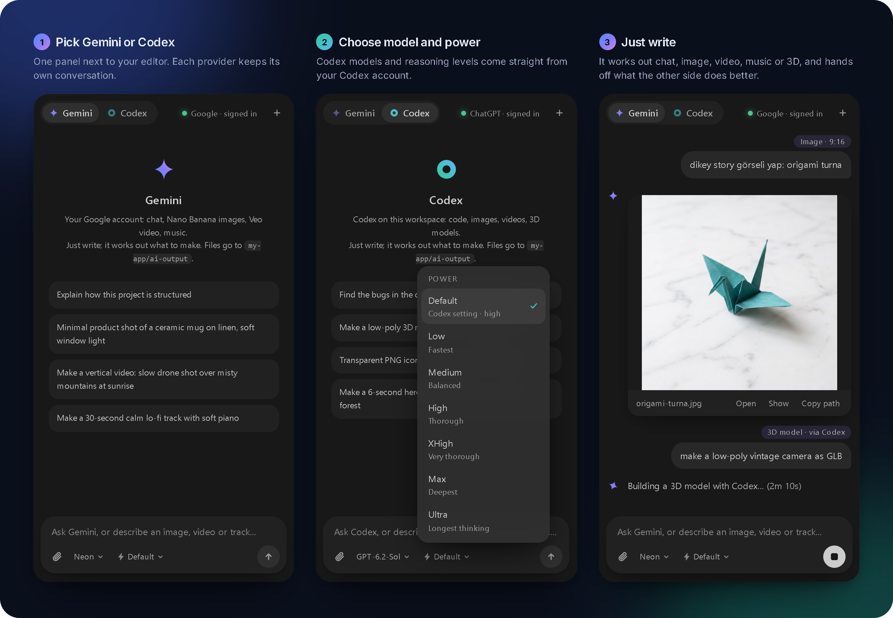
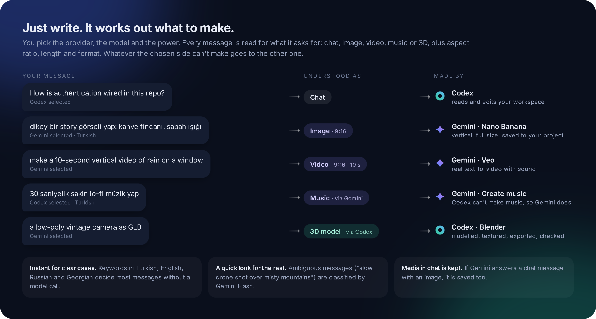
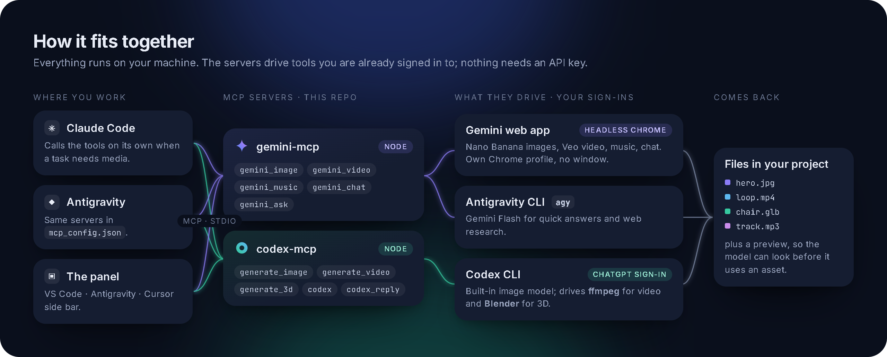
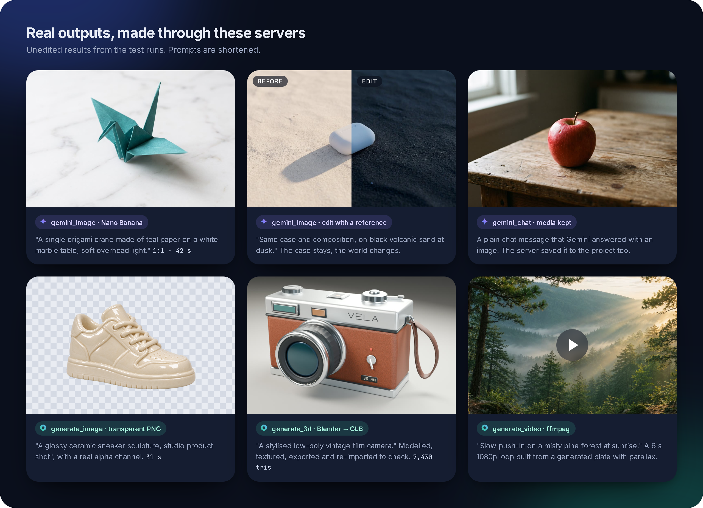

<p align="center">
  
</p>

<p align="center">
  <a href="LICENSE"></a>
  
  
  <a href="https://github.com/sxtrip34-cell/codex-gemini-mcp/actions/workflows/ci.yml"></a>
</p>

**Give Claude the image, video, music and 3D tools it doesn't have, using subscriptions you already pay for.**

Two small [MCP](https://modelcontextprotocol.io) servers connect Claude Code (and Antigravity, or any MCP client) to:

- **OpenAI Codex** on your machine, signed in with ChatGPT: image generation and edits, video built with ffmpeg or Blender, **3D models (GLB)** made in Blender, and a second coding agent.
- **Google Gemini**, signed in with your Google account: **Nano Banana** images and edits, **Veo** video, music, and the Gemini chat models.

No API keys. Claude decides when it needs an asset, calls the tool, gets the file in your project and a preview to check it. A side-bar panel for VS Code, Antigravity and Cursor puts both providers in one place.

<p align="center">
  
</p>

---

## Contents

- [Quick start](#quick-start)
- [What you need](#what-you-need)
- [What Claude gets](#what-claude-gets)
- [The panel](#the-panel)
- [How it works](#how-it-works)
- [Examples](#examples)
- [Configuration](#configuration)
- [Status](#status)
- [Privacy and safety](#privacy-and-safety)
- [Troubleshooting](docs/troubleshooting.md)
- [Contributing](#contributing)

## Quick start

```bash
git clone https://github.com/sxtrip34-cell/codex-gemini-mcp
cd codex-gemini-mcp
node scripts/install.mjs            # add --antigravity to register in Antigravity too
```

The installer runs `npm install`, checks which tools it can find, registers both servers with Claude Code (user scope) and installs the panel into VS Code, Antigravity and Cursor if their command-line tools are on your PATH. Run it with `--dry-run` first to see every step without changing anything.

Then sign in once on each side:

```bash
codex login              # or open the Codex app and sign in with ChatGPT
npm run gemini:signin    # opens a Chrome window on gemini.google.com; sign in, press Enter
```

Restart Claude Code and ask for something:

> *"Make a 16:9 hero image for this landing page and put it in `public/img`."*
> *"Build a low-poly 3D model of a desk lamp as GLB for the three.js scene."*
> *"Make an 8-second vertical video of rain on a window for the story ad."*

<details>
<summary>Manual setup (any MCP client)</summary>

```bash
npm install
claude mcp add --scope user codex  -- node /path/to/codex-gemini-mcp/packages/codex-mcp/server.mjs
claude mcp add --scope user gemini -- node /path/to/codex-gemini-mcp/packages/gemini-mcp/server.mjs
```

For other clients, use the same command and arguments in their MCP config, for example:

```json
{
  "mcpServers": {
    "codex":  { "command": "node", "args": ["/path/to/codex-gemini-mcp/packages/codex-mcp/server.mjs"] },
    "gemini": { "command": "node", "args": ["/path/to/codex-gemini-mcp/packages/gemini-mcp/server.mjs"] }
  }
}
```
</details>

## What you need

| For | You need | Notes |
|---|---|---|
| Everything | **Node.js 20+** | |
| `codex-mcp` | **Codex** (desktop app or `npm i -g @openai/codex`), signed in with ChatGPT | The server finds the CLI by itself, including the copy inside the Codex app. |
| Video with Codex | **ffmpeg** | Also used for previews. |
| 3D with Codex | **Blender** | Runs headless. |
| `gemini_image`, `gemini_video`, `gemini_music`, `gemini_chat` | **Google Chrome** and a Google account | Runs headless with its own profile. A Google AI plan raises the limits; Veo needs a paid plan. |
| `gemini_ask` | **Antigravity** (`agy` CLI), signed in | Optional. |

## What Claude gets

**codex-mcp**

| Tool | What it does |
|---|---|
| `generate_image` | Codex's built-in image model: generate, edit (`edit_image`), variants, transparent cut-outs, reference images. |
| `generate_video` | MP4 built from generated plates with camera moves and parallax (ffmpeg), Blender camera animation, or code-rendered motion. |
| `generate_3d` | Codex models the object in Blender, adds PBR materials and textures, exports GLB/glTF/FBX/OBJ/STL/USDZ, renders a preview and re-imports the file to check it. |
| `codex` / `codex_reply` | Hand any task to Codex in a folder (read-only, or `workspace-write` to edit), and continue the session. |
| `codex_status` / `codex_job` | Sign-in, models and reasoning levels; wait for or cancel long jobs. |

**gemini-mcp**

| Tool | What it does |
|---|---|
| `gemini_image` | Nano Banana: generate (about 2.8K), or edit an uploaded image. Aspect `1:1 / 9:16 / 3:4 / 4:3 / 16:9`, image or GIF. |
| `gemini_video` | Veo text-to-video or image-to-video, landscape or portrait. *Experimental, see [Status](#status).* |
| `gemini_music` | A track as MP3 (or MP4 with cover art). |
| `gemini_chat` | The Gemini web models with mode and thinking level; your default mode is restored afterwards. Media in the answer is saved too. |
| `gemini_ask` | Gemini Flash through the Antigravity CLI: fast answers and web research, read-only by default. |
| `gemini_status` / `gemini_job` | Sign-in check (opens a window only to sign in); wait for or cancel jobs. |

Long jobs (video, 3D) return a `job_id` first; the client waits with `codex_job` / `gemini_job`. Every result carries the file paths, a small preview image, and an id to refine the same session ("make it warmer", "fewer polygons").

Full parameter lists: [docs/codex-mcp.md](docs/codex-mcp.md) · [docs/gemini-mcp.md](docs/gemini-mcp.md)

## The panel

<p align="center"></p>

The panel is a side bar for VS Code, Antigravity and Cursor that talks to the same two servers. You choose the provider, the model and the power, and then just write. The panel decides whether a message is chat, image, video, music or 3D, and reads aspect ratio, length and format from the wording. Anything the chosen provider can't make goes to the other one.

<p align="center"></p>

More in [docs/panel.md](docs/panel.md).

## How it works

<p align="center"></p>

- **codex-mcp** runs `codex exec --json` in a sandbox. Images come from Codex's built-in image model. The server takes the files straight from Codex's own store, so it doesn't rely on the model to copy them. Video and 3D jobs get a work folder and the toolbox on your machine (ffmpeg, Blender, Node, Python).
- **gemini-mcp** answers text through the Antigravity CLI and makes media in the Gemini web app, inside a dedicated Chrome profile that runs **headless**: no window, no focus stealing. Each job uses its own tab. One lock, shared across server processes, serialises clicks and downloads.
- Both servers are plain Node.js with one dependency each, the MCP SDK (plus `playwright-core` for Gemini), so they are easy to read and change.

## Examples

<p align="center"></p>

## Configuration

Both servers work without configuration. Environment variables cover what you might want to change:

| Variable | Default | |
|---|---|---|
| `CODEX_MCP_OUTPUT_DIR` / `GEMINI_MCP_OUTPUT_DIR` | `~/Pictures/Codex` / `~/Pictures/Gemini` | Used when a call gives no `output_dir`. |
| `CODEX_MCP_WAIT_SECONDS` / `GEMINI_MCP_WAIT_SECONDS` | `280` | How long a call waits before it returns a `job_id`. |
| `CODEX_MCP_BUILD_SANDBOX` | `workspace-write` | Sandbox for Codex video/3D jobs. |
| `GEMINI_MCP_HEADLESS` | `1` | `0` shows the Chrome window. |
| `CODEX_PATH`, `AGY_PATH`, `CHROME_PATH`, `FFMPEG_PATH`, `BLENDER_PATH` | auto | Override tool locations. |

All variables: [docs/codex-mcp.md](docs/codex-mcp.md#configuration) · [docs/gemini-mcp.md](docs/gemini-mcp.md#configuration)

## Status

| | Status |
|---|---|
| Windows 11 | Tested end to end (Codex app, Chrome, Antigravity, Claude Code, VS Code/Antigravity panel). |
| macOS, Linux | Should work (cross-platform lookups are in place), not tested yet. Reports welcome. |
| Codex image / video / 3D / chat | Working. |
| Gemini image, edits, music, chat, `gemini_ask` | Working. |
| Gemini **Veo** video | **Experimental.** The flow is implemented, but during release testing Gemini answered with errors instead of a video ("I'm having a hard time…"), which may be quota or region related. The tool returns Gemini's message instead of hanging. |

## Privacy and safety

- **Everything runs locally.** The servers use the sign-ins you already have; no keys or tokens are stored by this project. Codex keeps its own sign-in (`~/.codex`); the Gemini Chrome profile lives in `~/.gemini-mcp/chrome-profile`.
- **Gemini web automation.** `gemini_image/video/music/chat` drive Google's consumer web app, which has no official API for this. Keep use personal and low-volume, and be aware that automating a consumer web app may conflict with its terms. If Google changes the page, the selectors in `packages/gemini-mcp/web.mjs` need an update. While the headless Chrome runs, its DevTools port (`127.0.0.1:9339`) is reachable by programs on your machine.
- **Codex runs sandboxed.** Image jobs are read-only. Video and 3D jobs can write only to their work folder and the output folder. The `codex` tool is read-only unless the caller asks for `workspace-write`. In the panel, Codex chat uses `workspace-write` in the open folder, like the Codex extension's agent mode.
- Generated files go where you point them and are never overwritten (`name-v2.png`).

## Contributing

Issues and pull requests are welcome. See [CONTRIBUTING.md](CONTRIBUTING.md) for the layout, the test commands and how to regenerate the README graphics. For security reports, see [SECURITY.md](SECURITY.md).

## License

[MIT](LICENSE)

---

<sub>This is an independent community project. It is not affiliated with or endorsed by Anthropic, OpenAI or Google. Claude, Codex, ChatGPT, Gemini, Nano Banana, Veo and Antigravity are trademarks of their respective owners. The marks used in the graphics are original artwork.</sub>
