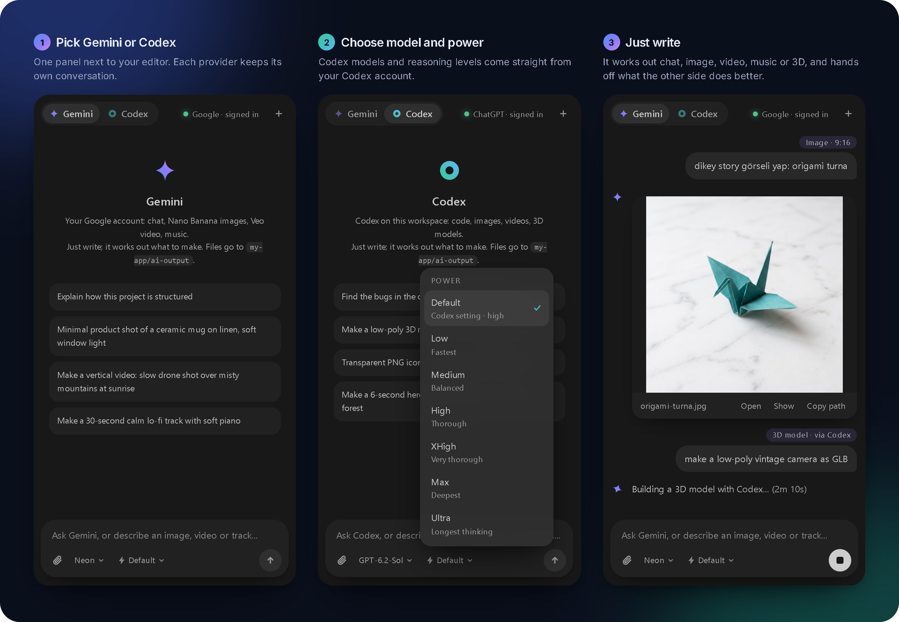

# The Codex · Gemini panel

A side-bar extension for **VS Code, Antigravity and Cursor** (any VS Code-based editor with a secondary side bar) that talks to `codex-mcp` and `gemini-mcp`. It starts both servers itself and speaks MCP to them over stdio, with no SDK in the extension.



## Using it

- **Provider:** the switch at the top picks Gemini or Codex. Each keeps its own conversation; **+** starts a new one.
- **Model and power:**
  - Gemini: *Neon*, *Hydrogen*, *Auto*, or *Flash* (Antigravity CLI, reads the open workspace). Power is the thinking level for Neon, or the Flash low/medium/high model.
  - Codex: the models your account lists (read with `codex_status`), with each model's reasoning levels. *Default* means your Codex config.
- **Just write.** The panel decides what the message is for:

| It reads | It does |
|---|---|
| a question, text, code | chat with the chosen provider |
| an image request, or an attached image plus an edit ("remove the background") | image (Nano Banana or Codex `image_gen`) |
| a video request, or "animate this" with an image | video (Veo or Codex) |
| a music request | music (Gemini; from Codex it is handed to Gemini) |
| a 3D model request | 3D (Codex + Blender; from Gemini it is handed to Codex) |

Aspect ratio ("vertical", "story", "16:9", "square"), video length ("10 seconds") and 3D format and detail ("GLB", "low-poly") are read from the wording too. The user's message gets a tag such as *Image · 9:16* or *3D model · via Codex*.

The router (`packages/vscode-panel/router.js`) decides clear cases instantly by keywords in Turkish, English, Russian and Georgian. Only ambiguous messages ("slow drone shot over misty mountains") are classified by Gemini Flash, which takes a few seconds. New languages are a few regex words away; see the tests in `packages/vscode-panel/test/router.test.js`.

- **Codex chat edits files.** It runs in the open folder with `workspace-write`, like the Codex extension's agent mode. Follow-ups continue the same Codex session.
- Results show inline: images, video and audio players, and 3D files with their preview. Each has **Open**, **Show** and **Copy path**. Files go to `<workspace>/ai-output` unless you set `codexGemini.outputDir`.

## Settings

| Setting | Default | |
|---|---|---|
| `codexGemini.geminiServerPath` | empty | Path of `packages/gemini-mcp/server.mjs`. Empty: found automatically. |
| `codexGemini.codexServerPath` | empty | Path of `packages/codex-mcp/server.mjs`. Empty: found automatically. |
| `codexGemini.nodePath` | empty | Node.js executable; empty uses `node` on PATH. |
| `codexGemini.outputDir` | empty | Output folder; empty uses `<workspace>/ai-output`. |

The servers are found in this order: the settings above, the clone recorded by the installer in `~/.codex-gemini-mcp/install.json`, and the repository itself when the extension runs from a clone. Logs go to the **Codex · Gemini** output channel.

## Build and install by hand

```bash
npm run panel:package                                   # -> dist/codex-gemini-panel.vsix
code --install-extension dist/codex-gemini-panel.vsix  # or antigravity-ide / cursor
```

Then reload the window (**Developer: Reload Window**). The panel appears in the secondary side bar, and a button opens it from the editor title bar.
